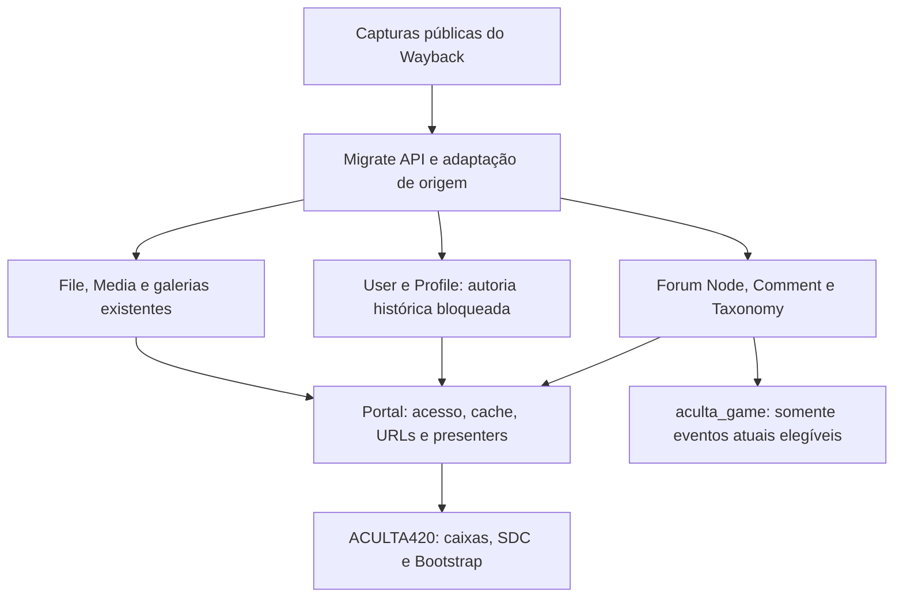

# Arquitetura — ACULTA Fórum

Status: arquitetura de implementação planejada para o plano aprovado.
Baseline: Drupal 11.3+, código instalado e normas do Portal. Metadados de
compatibilidade de contrib não substituem homologação no Core/PHP do projeto.

## Fronteiras

O submódulo integra capacidades existentes. Não reconstruir a listagem nativa em
um controller próprio sem demonstrar uma lacuna real. Usar as rotas, view modes,
templates do Forum e Views conforme seu papel. Navegação usa Menu API quando aplicável.
Mover hooks existentes entre módulos apenas em fase própria, com paridade comprovada.

## Domínio e publicação

O nome público passa a Growroom. O identificador funcional `forum` permanece para
DomainPurposeManager, ContentPurposeResolver e políticas já existentes. Um ID
Domain não é marca pública: renomeá-lo sem necessidade quebraria referências.

A fase operacional declara a troca de prefixo no mapeamento do Deployer, deriva
hosts por ambiente e verifica DNS, certificado, Apache no teste, LiteSpeed em
produção, trusted hosts, cookies, aliases, front path, canonical, sitemap e e-mail.
Nenhum host novo é fixado em PHP, Twig, JavaScript ou configuração exportada.
Não realizar deploy em produção como consequência de commit/merge.

Administração e transações Commerce continuam em MAIN. Formulários do Fórum
submetem no próprio host correto; requisições mutáveis não cruzam hosts por redirect.

## Autoria histórica e memorial

- Cada autor comprovado tem seu User bloqueado, com ID de origem estável e papel
  `usuarios_legados_forum` (machine name proposto; rótulo aprovado).
- A conta guarda a autoria individual de Nodes/Comments. Não usar um único User
  para todo o acervo e não misturar autores homônimos de IDs diferentes.
- Separar o nome técnico único da conta do nome histórico de exibição. Não inventar
  identidade, e-mail, registro, datas ou vínculo com conta atual.
- Profile/Entity API guardam metadados necessários. Não criar tabela de autores
  paralela à identidade User. Mapas de importação pertencem à Migrate API.
- `/u/lendashistoricas` é a única página pública de memorial: pode listar, pesquisar
  e paginar nomes no mesmo caminho. Não há subrota pública por pessoa.
- O link "Nome histórico" em uma publicação aponta ao memorial coletivo; o texto
  mantém o autor real daquele item. Avatar igual não significa autoria igual.
- A regra comum de `/u/<apelido>` continua para membros atuais. Um resolver de
  identidade no Portal deve selecionar o destino público antes de chegar ao tema.
- Core canonical de usuário, Views, busca e caixas de autor não podem reabrir um
  perfil público individual de legado. Administração de User permanece no Core.
- Reservar o literal `lendashistoricas`, verificar eventuais colisões e dar
  prioridade à rota estática. Não renomear uma conta existente automaticamente.

O memorial usa o contexto de perfis do purpose MAIN, como o contrato atual. A
URL absoluta é preparada por DomainPurposeManager; Twig não concatena `/u/`.

## Avatar e caixas existentes

Criar um asset original específico para as lendas históricas, com identidade
Growroom/ACULTA, legibilidade pequena e o mesmo espaço ocupado pelos avatares atuais.
O asset será versionado com origem/licença e variantes apenas se necessárias ao
contrato visual; sua criação pertence à fase visual, não a esta documentação.

Integrar ao AvatarPool/File/Image existente como opção reservada e determinística
para legados, sem colocá-la no sorteio geral. Validar file usage, limpeza e cache;
o mesmo arquivo pode ser referenciado sem duplicação por autor. Preservar fotos
históricas recuperadas como acervo quando pertinente, sem substituir a escolha
aprovada de avatar memorial. Não alterar ações de recorte/sorteio de membros atuais.

Reutilizar caixas de autoria, perfis, estados e diálogos do sistema. O Portal
entrega nome, destino coletivo, avatar renderizável e estado histórico; o tema
seleciona apresentação. Não introduzir outra UI de login, amizade ou mensagem.

## Acervo e conversas atuais

Um tópico histórico usa Node `forum`, com respostas Comment e comentários fechados.
Guardar fonte original e captura efetivamente usada, distinguindo data autoral,
data de captura e data de importação. Evitar que o import altere "novidades".

"Continuar esta discussão" cria um tópico atual com referência Entity API ao
histórico. Validar acesso e as regras atuais de criação; não contornar o limite
de participação. Distinguir autor original e pessoa que iniciou a nova conversa.
Preservar sequência, autores e datas do original; se uma página não foi recuperada,
mostrar a lacuna. Não preencher respostas com texto gerado.

## Integrações

| Integração | Contrato |
| --- | --- |
| Revista | Preservar `ForumTopicSync`, pasta Revista, `field_discussao` e abertura derivada; não criar segundo tópico |
| Galerias | `aculta_gallery`/Media Gallery/File/Media; respeitar D13 e acesso em MAGAZINE; vídeos não são imagens de galeria |
| Wiki/projetos | Referências a entidades reais e discussão vinculada quando habilitada |
| Loja | Referência ao produto, discussão pública e CTA para SHOP; pedido e dados pessoais na área privada; checkout em MAIN |
| Messenger/amizade | APIs atuais para contas elegíveis; legados bloqueados não recebem conversas, amizade ou notificações |
| Flag | Seguir/salvar existentes; sinalização de tópico/comentário sem contador paralelo |
| Gamificação | Eventos atuais aprovados; importação e contas legadas são inelegíveis |

## Acesso e cache: condição para o LMS

O LMS mantém curso, matrícula, atividade e progresso. Um tópico reservado será
vinculado ao contexto de curso e, se necessário, turma. Atividade referenciada
por cursos diferentes não deve unir suas conversas sem decisão explícita.

Avaliar Group/`gnode`, já presente no código, antes de qualquer acesso custom.
Não presumir que basta associar o Node a um grupo: ForumManager faz consultas
próprias; Search API tem integração de acesso Group ainda discutida upstream.
Validar rotas diretas, listagens nativas, contagens, último autor, busca, facetas,
trechos, perfil, feed, notificações, cache e arquivos. Até essa prova, conteúdo
LMS reservado não entra no índice público nem nos resumos públicos.

Hoje `DiscussionHooks::nodeView()` checa publicação do tópico e consulta comentários
com `accessCheck(FALSE)`, sem verificação explícita de `topic->access('view')` no
trecho. A extensão a conteúdo reservado exige corrigir esse contrato primeiro;
esta observação de código não afirma vazamento de conteúdo privado já existente.

Render arrays e decisões de acesso acumulam CacheableMetadata. Invalidar por
Node/Comment/User/Profile/File/Flag/matrícula conforme dependências reais. Também
proteger autocomplete e datas: ocultar só o corpo não basta.

Referências e limites da pesquisa estão em [PESQUISA.md](PESQUISA.md).
