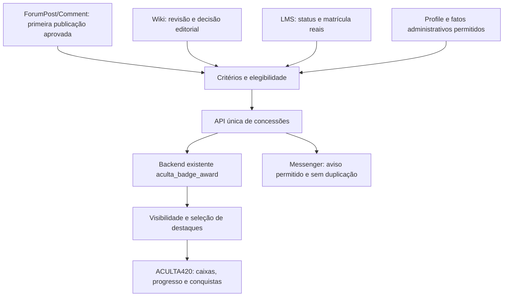

# Arquitetura — ACULTA Game

Status: arquitetura aprovada em evolução. G1–G5.4 têm código; o início de G7
(integração Forum dev.10) está implementado com Runtime DEFERRED. Evidências e
limites em [EXECUCAO.md](EXECUCAO.md). Partes futuras continuam propostas.

## Fontes e responsabilidades

O Game conhece critérios, progresso, elegibilidade e apresentação neutra. User/
Profile mantêm identidade e preferências; Forum/Comment, Wiki e LMS mantêm seus
dados. Commerce mantém pedidos e pagamentos; Game não cria carteira, créditos ou
benefícios. O tema recebe renderables e valores simples, com acesso/cache resolvidos.

## Definição, progresso e conquista são fatos distintos

| Conceito | Modelo previsto |
| --- | --- |
| Definição | Configuração exportável: identificador, versão do critério, descrição, fonte, escopo e condição |
| Progresso | Consulta da fonte real, conforme o usuário e o escopo; não espelhar contagens em outra tabela |
| Concessão | Fato histórico no backend único, com pessoa, conquista, origem e data |
| Evidência | Referência mínima à entidade/versão que justificou a concessão; acesso independente |
| Preferência | Ocultar tudo/itens e escolher destaques/ordem via Profile/User API; não altera o fato conquistado |

Uma missão pode ter etapas e progresso sem exigir pontuação. Evitar um novo motor
genérico de workflow: começar com critérios predefinidos e configuration schema.
Se ECA for adotado, eventos/condições chamam a mesma API de concessão; ECA não
vira backend de conquistas nem recebe acesso irrestrito às fontes por conveniência.

## Transição do que já existe

O checkout mantém `BadgeCatalog`, `BadgeService` e `BadgeAward` no `aculta_user`.
G1 transferiu `BadgeEvaluationHooks` ao Game e preservou `aculta_badge_award`,
IDs, datas e revogações. G2 modifica as condições dos gatilhos e serializa a API.

Não mover o provider da entidade só para adequar namespace. Mudança de provider
afeta discovery, instalação e uninstall e exige update/migração próprios com
backup e teste. Enquanto essa mudança não for demonstrada necessária, o storage
continua no User e o Game assume apenas responsabilidades explicitamente migradas.

Cada gatilho tem um único avaliador ativo. Trocar ownership dos hooks requer
desativar o caminho antigo e provar paridade no mesmo conjunto de mudanças.
`aculta_user` e o Portal principal não ganham dependência obrigatória do Game.
Desabilitar Game não apaga identidade, posts, cursos ou concessões.

### Integração com o Fórum público

O caminho Comment de `0.1.0-dev.10` escuta o bundle atual
`aculta_discussion_post`, campo `field_aculta_discussion`, hospedado no Node
`aculta_forum_topic`. Desde `0.1.0-dev.16`, hooks genéricos `entity_insert` e
`entity_update` também avaliam `aculta_forum_post`, sem importar a classe ou
declarar dependência do Game ao Fórum. O mesmo trigger `forum_comment` mantém o
catálogo, a missão e a API única de concessões. Aprovação posterior de post
pendente conta uma vez; insert/update sincronizados, autoria histórica, tópico
não publicado ou fora do Domain `forum`, revisão que não é default e edição de
post já publicado não concedem uma nova conquista.

O par contrib antigo (`comment_forum` em `forum`) não é elegível, mesmo enquanto
o módulo aguarda a retirada segura documentada em `aculta_forum`. Somente
Comments ACULTA vigentes e posts revisionáveis públicos podem qualificar.
`field_autor_legado` e
`SynchronizableInterface::isSyncing()` também bloqueiam concessões por conteúdo
histórico/restaurado. Não se reavalia o passado e não se cria cópia dos
comentários ou contadores no Game. O evento atual é o hook de entidade Drupal;
não há fila assíncrona nem módulo adapter adicional. A versão dev.11 substitui
explicitamente o caminho transitório documentado na dev.10.

## Lacunas observadas no código atual

Leitura de `868626d`, não auditoria funcional de Runtime:

- O primeiro comentário concede a badge no `comment_insert` somente se publicado.
  Um comentário aprovado depois é um caso necessário, pois a moderação inicial
  o salva não publicado. Tratar a transição de publicação sem conceder a cada edição.
- A primeira edição Wiki é avaliada em `node_update`; conferir revisão nova,
  autoria, estado editorial e critérios de aceitação antes de ampliar a regra.
- `BadgeService::award()` consulta e depois cria. Provar unicidade com duas
  requisições/workers concorrentes; idempotência de uma chamada não basta.
- `commerce_order_update` considera estado `completed`; distinguir evento novo,
  tipo de pedido e significado do reconhecimento Apoiador já existente.
- Perfil básico exige campos pessoais, inclusive WhatsApp; a expansão do Game
  precisa revisar a finalidade desse critério, sem pedir dados novos por recompensa.
- Verificar access handler/permissões, consultas e cache de `aculta_badge_award`
  antes de oferecer listagem pública, feed ou API.

Nenhuma dessas observações autoriza apagar concessões existentes ou reclassificar
seus titulares. Reavaliações precisam de uma política explícita de migração.

## Elegibilidade e integridade

Desde G5.1, o User oferece `AchievementDefinitions` como catálogo configurável,
fonte de `BadgeService::definitions()`. A Config API de User mantém overrides e
defaults estáveis, schema e gatilhos enumerados. Game entrega formulários de
criação/edição; as demais apresentações e fontes consultam a mesma definição.
Editar gatilhos não executa backfill. Criteria versão avança quando muda o conjunto
de gatilhos; alteração de nome não muda a identidade ou reconcede um marco.

Cada concessão registra sua origem real: manual com ator/data/motivo interno,
ou automática. Revogação considera a origem do registro, preservando o fato
automático mesmo quando a definição passa a permitir concessão administrativa.
User update 10003 instala somente campos opcionais de motivo na entidade existente.
Histórico administrativo é consulta paginada dessa entidade, não storage paralelo.

Revalidar publicação, matrícula quando pertinente, conta ativa e fonte antes de
conceder. Uma ação não confere permissão editorial nem privilégios de matrícula.
Posts importados e contas legadas bloqueadas são inelegíveis, mesmo com autores
individuais válidos. Não depender só de uma flag temporária do importador.

Usar transação/lock e restrição de unicidade adequada no backend único. Fixar
a semântica da chave: conquista e pessoa para marcos únicos; missões recorrentes
só com escopo e período aprovados. Uma mudança de texto/configuração não deve
reconceder automaticamente um marco já conquistado.

Queue API serve a avaliações custosas; worker revalida as condições atuais e
respeita tentativas, limites e retomada. Não usar estado de sessão como prova.
Concessão administrativa exige permissão restrita, motivo e ator auditável.

## Visibilidade aprovada

G3 implementa o serviço `aculta_game.achievement_presentation`, o formulário
`AchievementDisplayForm` e hooks nos contratos neutros `aculta_user_public_profile`
e `aculta_user_activity_content`. A ausência de Game mantém User independente.
Os alters recebem render arrays, perfil ou aba/UID atual; não transferem Domain
ou serviços ao tema. Futuras caixas devem reutilizar `publicFor()`.

Preferências usam `UserDataInterface`, namespace `aculta_user`, chave
`game_achievement_display`: ocultação global, mapa de ocultação/destaque/peso por
ID do catálogo. O namespace do User preserva escolhas após desinstalar Game.
O formulário lê a pessoa da sessão e não aceita UID do cliente. Form API protege
o POST; o link da privacidade usa a rota existente da Conta.

Tags da entidade/lista de conquistas, perfil, usuário e
`aculta_game:display:<uid>` invalidam a projeção. `savePreferences()` invalida a
tag da pessoa. Lista própria varia por `user`; a pública contém a mesma seleção
para qualquer visitante e varia por idioma. Formulário não é cacheável.
Não há endpoint público de evidências, feed, autocomplete ou contador novo.

Conquistas elegíveis são públicas por padrão. A pessoa pode ocultar tudo,
ocultar conquistas específicas e escolher destaques/ordem. A política geral do
perfil e decisões explícitas de privacidade prevalecem: não usar as caixas do
Fórum para contornar um perfil privado.

A representação pública contém só dados permitidos da conquista. Referências de
evidência privada, nomes de cursos reservados, notas, valores/pedidos, endereço,
dados cadastrais e contato não são publicados automaticamente. Nem tooltip,
autocomplete, endpoint, contador ou preview pode revelar itens ocultados.

As preferências devem alcançar perfil, cartão de autor, página da conquista,
feed, busca e avisos públicos. Cache depende da concessão e das preferências;
variar por usuário/acesso quando houver evidência reservada. A opção de ocultar
não muda a matrícula ou o acesso ao conteúdo que originou a conquista.

Aviso privado de conquista usa Messenger/pilha existente, quando aprovado. Ele
precisa respeitar preferência de aviso, deduplicação e elegibilidade. Público
por padrão não significa enviar e-mail ou publicar no feed automaticamente.

## Catálogo de missões para revisão

| Proposta | Fonte | Critério a validar |
| --- | --- | --- |
| Primeira contribuição na comunidade | Comment | Primeira resposta atual publicada ou aprovada |
| Contribuição ao conhecimento | Node/revisão da Wiki | Revisão autoral aceita, conforme o workflow real |
| Primeira formação concluída | `lms_course_status` | Estado `passed`, sem confundir com matrícula ou compra |
| Curadoria de fontes | Conteúdo editorial/Wiki | Contribuição validada pela equipe, se houver registro proprietário do fato |
| Colaboração cultural | Registro administrativo existente | Concessão manual com motivo, sem inventar presença em atividade |
| Caminho de participação | Fontes das etapas acima | Progresso individual, limiares definidos pelo responsável |

Os rótulos e limiares são propostas, não catálogo já habilitado. O acervo Growroom
pode oferecer trilhas de leitura futuras, mas acesso a uma página não prova
aprendizagem nem autoria. Não gerar conquistas retrospectivas para legados.

## Apresentação

Reutilizar caixas do ACULTA420, Bootstrap, ícones e componentes de progresso e
estados. Mostrar critério, progresso, obtenção e motivo permitido, sem placar.
Respeitar teclado, leitores de tela, reduced motion e os dois modos de cor.
Não instalar imagens, medalhas ou fontes de terceiros sem verificar suas licenças.
